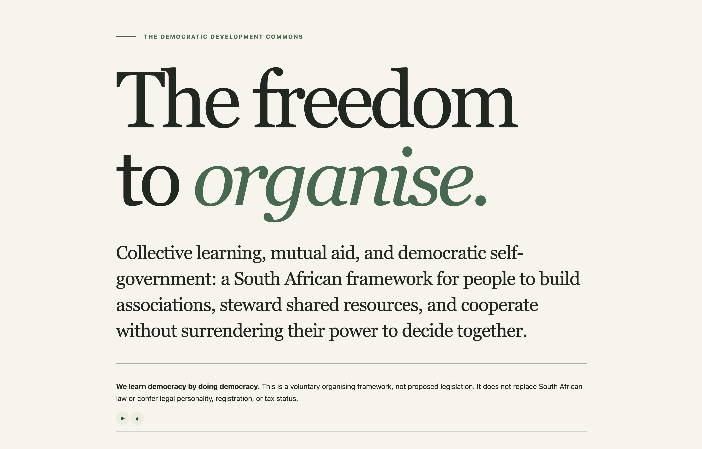

<p align="center"></p>

# The Democratic Development Commons

[](LICENSE-CC-BY-NC-SA-4.0.txt)
[](LICENSE)

Separate licences apply to content and software. [See the directory-to-licence map and scope](LICENSING.md#where-each-licence-applies).

Read the [Democratic Development Commons white paper — working version 1.7](grav-site/user/pages/01.en/04.white-paper/default.md), the conceptual basis for the framework.

The paper explores how democratic associations can rebuild emancipatory adult education in South Africa through collective learning, mutual aid, and shared governance. It brings South African organising traditions into dialogue with international ideas, examines the legal landscape, and proposes practical safeguards for accessibility, member control, accountability, and cooperation between autonomous associations. Part I develops the reasoning; Part II outlines a public framework; Part III examines criticisms, unresolved tensions, and future research. The paper also guides a planned Association Constitution Drafting Tool. It is a working proposal, not legislation or legal advice.



## The freedom to organise.

Collective learning, mutual aid, and democratic self-government: a South African
framework for people to build associations, steward shared resources, and cooperate
without surrendering their power to decide together.

**We learn democracy by doing democracy.** The framework is a voluntary organising
agreement, not proposed legislation. Adopting it does not confer legal personality,
registration, or tax status, and does not replace applicable law.

## Ten organising principles

1. Freedom and voluntary association.
2. Equal standing.
3. Collective self-government.
4. Difference without domination.
5. Substantive participation and accessibility.
6. Collective learning and inquiry.
7. Shared stewardship, mutual aid, and ecological responsibility.
8. Accountable power, dissent, and review.
9. Autonomy and federation.
10. Open-ended and reflexive development.

The [English proposal](grav-site/user/pages/01.en/proposal.md) presents Part II of the
white paper in a public framework. The site includes 13 language sections. The
proposal, drafting-tool description, and donation page have machine-generated
translations in the other written language editions, with English canonical-source
notices. Kaaps is an Afrikaans-based draft requiring Kaaps-speaker review. SASL
remains written-English support pending signed media; its pages are unchanged.

## Current website · 0.3.0

- **Association Constitution Drafting Tool:** a description of the planned tool at
  `/en/stadgar`, reached through the **Constitution Jumpstart** tab. The old builder
  is removed; no constitution-answer form is active.
- **Legal matrix:** 16 provisional research records, separate reform tracking, and
  JSON/schema downloads at `/en/legal-matrix`. All initial records await verification.
- **Governance-pattern library:** seven untested draft patterns, with suitability
  limits and evidence requirements, at `/en/governance-patterns`.
- **Contact:** `/en/contact` accepts participation enquiries and community-led translation proposals through the private interest form.
- **Language suggestions:** the English Suggest a language page matches registered names, publishes aggregate counts, and provides private super-admin review.
- **Join form:** `[project-interest /]` under Join on the English and translated proposals. It stores
  contact details privately, supports non-JavaScript submissions, and sends no emails.
  Super-admins review, search, and delete records in **Admin → Project interest**.
- **Reading tools:** day/night mode, 100%–400% text sizing, browser read-aloud,
  remembered prefiguration panels, translated navigation, and translation notices.
- **Downloads and footer:** public pages offer Markdown, RTF, and PDF downloads.
  English supporting documents are linked in the footer and omit the project tabs.

The multilingual site uses Grav with Git-backed Markdown. The published
[privacy notice](grav-site/user/pages/01.en/06.privacy/default.md) describes the actual
Join implementation; responsible-party/contact and production-hosting details remain
pending. Records are private runtime data, not public page content or Git content.

## Run the website

### 1. Install Git and Docker

Git downloads a copy of this project to your computer. Docker runs the website
and its editor for you. Follow the official installation instructions for your
operating system:

| Operating system | Install Git | Install Docker |
| --- | --- | --- |
| macOS | [Git for macOS](https://git-scm.com/install/mac) | [Docker Desktop for Mac](https://docs.docker.com/desktop/setup/install/mac-install/) or [Colima](https://colima.run/docs/installation/) |
| Windows | [Git for Windows](https://git-scm.com/install/windows) | [Docker Desktop for Windows](https://docs.docker.com/desktop/setup/install/windows-install/) |
| Linux | [Git for Linux](https://git-scm.com/install/linux) | [Docker Engine](https://docs.docker.com/engine/install/) and [Compose plugin](https://docs.docker.com/compose/install/linux/) |

Docker Desktop includes Docker Compose. After installing it, open Docker Desktop
and wait until it is running. On Windows, follow the Docker guide's WSL 2 setup
instructions and use Linux containers for this project.

**macOS without Docker Desktop:** [Colima](https://colima.run/docs/installation/)
runs the containers using the Docker CLI and Compose. Install [Homebrew](https://brew.sh/)
first, then run:

```sh
brew install colima docker docker-compose docker-buildx
mkdir -p ~/.docker/cli-plugins
ln -sfn "$(brew --prefix)/opt/docker-compose/bin/docker-compose" ~/.docker/cli-plugins/docker-compose
ln -sfn "$(brew --prefix)/opt/docker-buildx/bin/docker-buildx" ~/.docker/cli-plugins/docker-buildx
colima start
```

Continue with the same `docker compose` commands below. After restarting your
computer, run `colima start` again; use `colima stop` when finished. See the
official [Colima installation guide](https://colima.run/docs/installation/).

If you prefer Docker Engine on Linux, follow the official
[Docker Engine installation guide](https://docs.docker.com/engine/install/) for
your distribution and install the
[Docker Compose plugin](https://docs.docker.com/compose/install/linux/).

Open **Terminal** on macOS or Linux, or **Git Bash** (included with Git for Windows)
or **PowerShell 7+** on Windows. If your terminal
was open during installation, close it and open it again. Run these commands,
one line at a time, to check that the tools are available:

```sh
git --version
docker --version
docker compose version
```

Each command should print a version number. This project needs Docker Compose
2.20.3 or newer, using the `docker compose` command.

### 2. Clone and start

With Git installed and Docker Desktop or Colima running, run this single line
from the folder where you want to keep the project:

```sh
git clone https://github.com/dfdy/The-Democratic-Development-Commons.git && cd The-Democratic-Development-Commons && docker compose up -d --build
```

This creates `The-Democratic-Development-Commons/` in your current folder and starts the site.
The first build may take a few minutes. Nothing is installed globally by this command.

- Website: http://localhost:8388/en
- Editor: http://localhost:8388/admin

Retrieve the initial login:

```sh
docker compose exec --user www-data grav cat user/data/commons-private/admin-login.txt
```

Change the administrator password and email after signing in. Content edits are
saved directly to `The-Democratic-Development-Commons/grav-site/user/pages/` on your computer,
including uploaded page media. Docker mounts that folder into the site: edits stay
in the clone through container rebuilds and restarts and can be committed and merged
through Git. Keep and back up the cloned folder.

Accounts, passwords, private keys, and Join records persist separately in a Docker volume.
They are not committed to Git; deleting Docker volumes removes that private data. Protect backups separately.

See [Grav editing, setup and MCP instructions](grav-site/README.md).

To stop or restart the site:

```sh
docker compose stop
docker compose up -d
```

Use `docker compose up -d --build` after changing themes or plugins. Markdown
content changes appear without rebuilding. On Colima, the repository share must
be writable for the editor to save content; see the Grav setup guide.

## Licences and development

Different licences apply to the content and software:

| Material | Licence |
| --- | --- |
| Framework text, translations, glossary, constitution templates and first-party editorial images | [CC BY-NC-SA 4.0](LICENSE-CC-BY-NC-SA-4.0.txt) — attribution, noncommercial use and share-alike |
| Custom theme, plugins, scripts, tests and software documentation | [GNU AGPLv3 only](LICENSE) — software use, modification and sharing under its terms, including commercially |

These licences apply to separate material; they are not a choice of licence for
the same material. Third-party components retain their own licences. See
[full scope and exclusions](LICENSING.md).

See [development instructions](AGENTS.md). Accessibility target: WCAG 2.2 AA.
