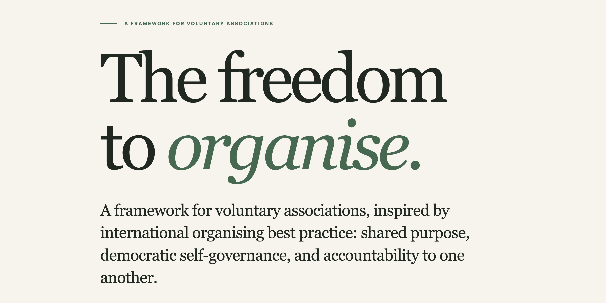

# Voluntary Associations: The Association Commons

[](LICENSE-CC-BY-NC-SA-4.0.txt)
[](LICENSE)

Separate licences apply to content and software. [See licence scope](LICENSING.md).

Read the [Democratic Development Commons white paper — working version 1.7](grav-site/user/pages/01.en/04.white-paper/default.md), the conceptual basis for the framework.

The paper explores how democratic associations can rebuild emancipatory adult education in South Africa through collective learning, mutual aid and shared governance. It brings South African organising traditions into dialogue with international ideas, examines the legal landscape, and proposes practical safeguards for accessibility, member control, accountability and cooperation between autonomous associations. Part I develops the reasoning; Part II outlines a public framework; Part III examines criticisms, unresolved tensions and future research. The paper also guides a future configurable constitution generator. It is a working proposal, not legislation or legal advice.



## The freedom to organise.

A framework for voluntary associations, inspired by international organising best practice: shared purpose, democratic self-governance, and accountability to one another.

The project supports rebuilding adult education in South Africa as an emancipatory practice of critical inquiry, mutual aid and collective action. The framework is a voluntary agreement, not legislation or a grant of legal status.

## Seven organising principles

1. **Freedom of association** — People freely form, join, support or leave associations.
2. **Collective self-governance** — Members determine their shared purposes and arrangements.
3. **Democratic member control** — Members participate in decisions, elections and oversight.
4. **Shared purpose** — Resources advance the association’s purpose rather than private gain.
5. **Constitutional governance** — Written rules define rights, responsibilities and fair procedures.
6. **Separate legal personality** — Where applicable law permits, an association can hold rights and obligations separately from its members.
7. **Accountability** — Delegated decision-makers answer to members.

The multilingual website runs on Grav, with Git-backed Markdown content.
Displayed version: **0.1.2**. Do not increment it without the project owner's instruction.

## Run the website

### 1. Install Git and Docker

Git downloads a copy of this project to your computer. Docker runs the website
and its editor for you. Follow the official installation instructions for your
operating system:

| Operating system | Install Git | Install Docker |
| --- | --- | --- |
| macOS | [Git for macOS](https://git-scm.com/install/mac) | [Docker Desktop for Mac](https://docs.docker.com/desktop/setup/install/mac-install/) or [Colima](https://colima.run/docs/installation/) |
| Windows | [Git for Windows](https://git-scm.com/install/windows) | [Docker Desktop for Windows](https://docs.docker.com/desktop/setup/install/windows-install/) |
| Linux | [Git for Linux](https://git-scm.com/install/linux) | [Docker Engine](https://docs.docker.com/engine/install/) and [Compose plugin](https://docs.docker.com/compose/install/linux/) |

Docker Desktop includes Docker Compose. After installing it, open Docker Desktop
and wait until it is running. On Windows, follow the Docker guide's WSL 2 setup
instructions and use Linux containers for this project.

**macOS without Docker Desktop:** [Colima](https://colima.run/docs/installation/)
runs the containers using the Docker CLI and Compose. Install [Homebrew](https://brew.sh/)
first, then run:

```sh
brew install colima docker docker-compose docker-buildx
mkdir -p ~/.docker/cli-plugins
ln -sfn "$(brew --prefix)/opt/docker-compose/bin/docker-compose" ~/.docker/cli-plugins/docker-compose
ln -sfn "$(brew --prefix)/opt/docker-buildx/bin/docker-buildx" ~/.docker/cli-plugins/docker-buildx
colima start
```

Continue with the same `docker compose` commands below. After restarting your
computer, run `colima start` again; use `colima stop` when finished. See the
official [Colima installation guide](https://colima.run/docs/installation/).

If you prefer Docker Engine on Linux, follow the official
[Docker Engine installation guide](https://docs.docker.com/engine/install/) for
your distribution and install the
[Docker Compose plugin](https://docs.docker.com/compose/install/linux/).

Open **Terminal** on macOS or Linux, or **Git Bash** (included with Git for Windows)
or **PowerShell 7+** on Windows. If your terminal
was open during installation, close it and open it again. Run these commands,
one line at a time, to check that the tools are available:

```sh
git --version
docker --version
docker compose version
```

Each command should print a version number. This project needs Docker Compose
2.20.3 or newer, using the `docker compose` command.

### 2. Clone and start

With Git installed and Docker Desktop or Colima running, run this single line
from the folder where you want to keep the project:

```sh
git clone https://github.com/dfdy/The-Association-Commons.git && cd The-Association-Commons && docker compose up -d --build
```

This creates `The-Association-Commons/` in your current folder and starts the site.
The first build may take a few minutes. Nothing is installed globally by this command.

- Website: http://localhost:8388/en
- Editor: http://localhost:8388/admin

Retrieve the initial login:

```sh
docker compose exec --user www-data grav cat user/data/commons-private/admin-login.txt
```

Change the administrator password and email after signing in. Content edits are
saved directly to `The-Association-Commons/grav-site/user/pages/` on your computer,
including uploaded page media. Docker mounts that folder into the site: edits stay
in the clone through container rebuilds and restarts and can be committed and merged
through Git. Keep and back up the cloned folder.

Accounts, passwords and private keys persist separately in a Docker volume.
They are not committed to Git; deleting Docker volumes removes that private data.

See [Grav editing, setup and MCP instructions](grav-site/README.md).

To stop or restart the site:

```sh
docker compose stop
docker compose up -d
```

Use `docker compose up -d --build` after changing themes or plugins. Markdown
content changes appear without rebuilding. On Colima, the repository share must
be writable for the editor to save content; see the Grav setup guide.

## Licences and development

Different licences apply to the content and software:

| Material | Licence |
| --- | --- |
| Framework text, translations, glossary, constitution templates and first-party editorial images | [CC BY-NC-SA 4.0](LICENSE-CC-BY-NC-SA-4.0.txt) — attribution, noncommercial use and share-alike |
| Custom theme, plugins, scripts, tests and software documentation | [GNU AGPLv3 only](LICENSE) — software use, modification and sharing under its terms, including commercially |

These licences apply to separate material; they are not a choice of licence for
the same material. Third-party components retain their own licences. See
[full scope and exclusions](LICENSING.md).

See [development instructions](AGENTS.md). Accessibility target: WCAG 2.2 AA.
